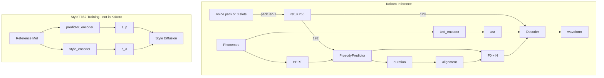

# Архітектура Kokoro / StyleTTS2: здогадки та дискусія

Нотатки з аналізу коду, voice pack і обговорення механізмів AdaIN, просодії та клонування.
Доповнює [`timbre_encoder_plan.md`](timbre_encoder_plan.md) і [`TODO_prosody.md`](TODO_prosody.md).

**Статус:** робочі гіпотези, підтверджені кодом і емпіричним аналізом пакетів; не всі пункти перевірені експериментально на великій вибірці.

---

## 1. Загальна картина

### Kokoro vs StyleTTS2

| | StyleTTS2 (повна) | Kokoro (дистиляція) |
|--|-------------------|---------------------|
| Параметри | ~200M+ | ~82M |
| Reference на інференсі | mel → 2 encoders | готовий voice pack `[510,1,256]` |
| `style_encoder` | є (тембр) | **немає** (pre-baked) |
| `predictor_encoder` | є (просодія) | **немає** (pre-baked) |
| Style Diffusion | є | **немає** |
| Модулі в `KModel` | повний стек | `bert`, `bert_encoder`, `predictor`, `text_encoder`, `decoder` |

Kokoro — **inference-only** дистиляція StyleTTS2: голос = попередньо запечений `ref_s`, індексований довжиною тексту.

### Розділення `ref_s [256]`

```python
# kokoro/model.py
s = ref_s[:, 128:]           # просодія → ProsodyPredictor
audio = self.decoder(..., ref_s[:, :128])  # тембр → Decoder
```

| Половина | Розмір | Модуль | Що керує |
|----------|--------|--------|----------|
| `[:128]` | тембр | Decoder (AdaIN1d) | хто говорить, тембр, форманти |
| `[128:]` | просодія | ProsodyPredictor | темп, F0, енергія, манера |

Voice pack: `[510, 1, 256]` — **510 слотів**, індекс `len(phonemes) - 1` (див. `kokoro/pipeline.py`).

---

## 2. AdaIN — як стиль «фарбує» мережу

### Формула

```
output = (1 + γ) × norm(x) + β
γ, β = Linear(style_vector)   # по одному на кожен канал
```

### Реалізація в Kokoro

**Decoder** — `AdaIN1d` (`kokoro/istftnet.py`):

- `InstanceNorm1d` по **часу** для кожного каналу окремо
- `style_dim=128` → `fc` → `2 × num_features` (γ і β)
- Застосовується в `AdaINResBlock1` і `AdainResBlk1d` на кожному residual block

**ProsodyPredictor** — два варіанти:

1. **`AdaLayerNorm`** (`kokoro/modules.py`) у `DurationEncoder` — LayerNorm + γ/β з просодії, вісь **фонем**
2. **`AdaIN1d`** у гілках F0 і N (`AdainResBlk1d`) — вісь **audio time**

### Що таке «канал»

**Не** аудіо L/R. **Канал** = один рядок у внутрішньому тензорі `[batch, channels, time]`:

- у decoder: сотні внутрішніх ознак (256, 512, 1024…) на кожен момент часу
- у DurationEncoder: 512 ознак **на кожну фонему**
- AdaIN задає **окремі γ, β для кожного каналу** — тонке налаштування стилю, не одне число на весь звук

### Чому не `x + style`

Контент (текст/форма сигналу) і стиль **розділені**: спочатку нормалізація прибирає «власний» стиль шару, потім γ/β з `ref_s` підставляють стиль голосу. Ідея з image style transfer (Huang et al., AdaIN).

---

## 3. Як працює вектор просодії `[128:]`

Просодійний вектор **не йде в decoder**. Він керує **як** говорити, не **чим** звучати.

### Три точки впливу в `ProsodyPredictor`

```
ref_s[128:] = s
    │
    ├─ (1) Concat у DurationEncoder
    │      [ознаки фонеми (512)] + [s (128)] → LSTM
    │      s.expand на кожну фонему
    │
    ├─ (2) AdaLayerNorm між LSTM-шарами
    │      (1+γ)·LayerNorm(x)+β, γ/β з s, по 512 каналах на фонему
    │
    └─ (3) AdaIN у гілках F0 і N
           AdainResBlk1d(F0, s), AdainResBlk1d(N, s)
           → F0_pred[time], N_pred[time]
```

### Повний потік інференсу

```
текст → BERT → d_en [512 × phonemes]
                    │
         s [128] ───┼→ duration (тривалість кожної фонеми)
                    │
              alignment (фонеми → audio frames)
                    │
              F0, N криві [time]
                    │
текст → text_encoder → asr ──┐
F0, N, ref_s[:128] ──────────┴→ decoder → waveform
```

---

## 4. Ключова здогадка: короткий mel ≠ повна просодія довгого тексту

### Проблема, яку ставили

Як з короткого reference mel (3–5 с) може вистачити інформації для просодії **дуже довгих** послідовностей?

### Відповідь

**Не вистачає — і не повинно.** `ref_s[128:]` — це **глобальний стиль мовлення** (128 чисел), не покадрова карта F0/пауз.

| Рівень | Джерело | Що задає |
|--------|---------|----------|
| **Глобальний** | encoder з mel → `s_p` [128] | середній темп, діапазон F0, енергія, «манера» |
| **Локальний** | текст + BERT + LSTM + conv | паузи, наголоси, мелодія речення, duration по фонемах |

Повна просодія на довгий синтез = **f(текст, s_p)**, де `s_p` лише **bias**, а структуру розгортає predictor.

### StyleTTS2 (діаграма зі статті)

На діаграмі **не один енкодер** співставляє mel з текстом:

```
Reference Mel ──┬── Prosodic Style Encoder  → s_p [128]
                └── Acoustic Style Encoder  → s_a [128]

Phonemes ──┬── Text Aligner (навчання)
           ├── Acoustic Text Encoder → decoder
           └── Prosodic Text Encoder (BERT) → h_bert

h_bert + s_p → Duration Predictor, Prosody Predictor (F0, N)
h_bert + s_p + s_a → Style Diffusion Denoiser (уточнення стилю під текст)
```

**Style Diffusion** (немає в Kokoro) додатково уточнює стиль під конкретне речення — навіть у повному StyleTTS2 короткий mel не несе всю просодію сам.

### Навчання (чому не потрібен лінійний зв'язок)

При тренуванні є **ground truth** з того ж аудіо:

- alignment → duration GT
- pitch extractor → F0, N GT
- losses на duration, F0, N, mel, adversarial

Encoder `s_p` навчається **end-to-end**: 128 чисел корисні, якщо допомагають predictor передбачити GT. Явна формула «mel frame → phoneme» не потрібна.

### Kokoro — заміна diffusion + encoder

На інференсі mel **не кодується**. Замість runtime encoder + diffusion:

```python
# kokoro/pipeline.py
model(ps, pack[len(ps)-1], speed)
```

510 **попередньо запечених** `ref_s` під різні довжини тексту. Це артефакт дистиляції: офлайн підібрали просодію для кожного length-regime.

---

## 5. Емпіричні спостереження (voice pack analysis)

Аналіз офіційних пакетів (`af_heart`, інші):

### Між спікерами (слоти 50–510)

- L1 між `[:128]` (тембр) і `[128:]` (просодія) — **подібний порядок** (~0.10–0.13)
- Обидві половини несуть ідентичність, але різні аспекти

### Всередині одного спікера (слоти 0→509)

- **Тембр `[:128]`** — майже стабільний між слотами
- **Просодія `[128:]`** — повільна зміна (~0.001 L1/step), стрибок на slot 0; slot 0→509: L1 ~0.2–0.5
- **Norm trajectories** просодії між спікерами: кореляція **>0.99** (та сама крива по довжині, різний offset)

### Висновок для клонування

Один `ref_s` + `expand(510,1,256)` (як у `cloned_voice_*`) **псує** довгі тексти: просодія слота 50 ≠ слота 400.

---

## 6. Рекомендації для клонування (консенсус дискусії)

### Тембр

- Оптимізувати або кодувати **лише `[:128]`**
- `TimbreEncoder` (StyleEncoder CNN) → mel 3–10 с → `[128]`
- Warm-start з StyleTTS2-LJSpeech `style_encoder` (потрібен key mapper для `spectral_norm`)

### Просодія

- **Не** оптимізувати з reference audio
- Брати `[128:]` з baseline voice pack по слоту:
  - female: `af_heart`, `af_bella`
  - male: `am_michael`, `am_puck`

### Збірка pack

```python
from timbre_encoder import assemble_voice_pack, make_ref_s

pack = assemble_voice_pack(timbre, baseline_pack)  # [510, 1, 256]
ref_s = make_ref_s(timbre, baseline_pack, len(phonemes))
```

Реалізація: `timbre_encoder/voice_pack.py`.

### Plan B (StyleTTS2 encoder без дистиляції)

Пряме підключення encoder weights до Kokoro **без** gradient opt / distillation: оцінка реалізму **~15–25%**. Краще як warm-start, не як фінальне рішення.

---

## 7. Відкриті питання та гіпотези

| # | Гіпотеза | Статус |
|---|----------|--------|
| 1 | Просодійні слоти 0–509 кодують length-conditioned «режим» мовлення, а не контент | підтримано аналізом norm trajectories |
| 2 | Slot 0 — outlier (padding/BOS?), не використовувати для висновків | спостереження, не доведено |
| 3 | Timbre-only opt + baseline prosody виправить whisper/decay на довгих текстах | логічно з архітектури; **ще не імплементовано** в `cloned_voice_*` |
| 4 | Teacher dataset з timbre-only `kokoro_revers` достатній для supervised encoder | план у `timbre_encoder_plan.md` |
| 5 | Distillation через frozen Kokoro decoder критична для якості encoder | гіпотеза з плану; етап 2 не запущений |
| 6 | Як саме офлайн запікали 510 слотів у HF voice packs | **невідомо** (немає публічного `(audio, ref_s)` для official voices) |

---

## 8. Обмеження та чесні межі

### Що працює

- Глобальний стиль з 3–5 с reference (тембр)
- Текст-умовна просодія на синтез довільної довжини (до 510 фонем)
- 510 слотів baseline prosody під length-regime

### Що не працює / слабко

- Один `ref_s` на всі довжини (`expand`)
- Копіювання точної інтонації довгого монологу з короткого sample
- Просодія з reference mel без diffusion (у Kokoro diffusion немає)
- Plan B encoder-only без distillation

### Ліміти Kokoro

- Макс. **510 фонем** на один forward (`context_length`)
- Довші тексти — chunking у pipeline (розбиття на сегменти)

---

## 9. Діаграма (спрощена, для навігації)



---

## 10. Пов'язані файли

| Файл | Зміст |
|------|-------|
| `kokoro/model.py` | split `ref_s`, forward |
| `kokoro/modules.py` | `ProsodyPredictor`, `DurationEncoder`, `AdaLayerNorm` |
| `kokoro/istftnet.py` | `AdaIN1d`, `Decoder`, `AdainResBlk1d` |
| `kokoro/pipeline.py` | `pack[len(ps)-1]`, chunking |
| `timbre_encoder/` | encoder, mel preprocess, `assemble_voice_pack` |
| `documentation/timbre_encoder_plan.md` | 3-stage training plan |
| `documentation/TODO_prosody.md` | timbre-only opt checklist |
| `cloned_voice_scale/`, `cloned_voice_demo/` | gradient opt experiments |
| `demo/kokoro_revers/` | gradient sandbox |

---

## 11. Аналогія (з дискусії)

**Режисер** (`s_p` / `ref_s[128:]`) — «актор говорить швидко, з емоцією, у такому діапазоні».

**Сценарій** (текст / BERT) — «тут пауза, тут питання, тут наголос».

**Актор** (predictor) — читає сценарій у стилі режисера; не відтворює дослівно 3-секундний sample.

**Грим** (`s_a` / `ref_s[:128]`) — тембр голосу (decoder / AdaIN).

---

*Останнє оновлення: дискусія про AdaIN, канали, просодію, StyleTTS2 diagram, короткий mel vs довгий текст.*
